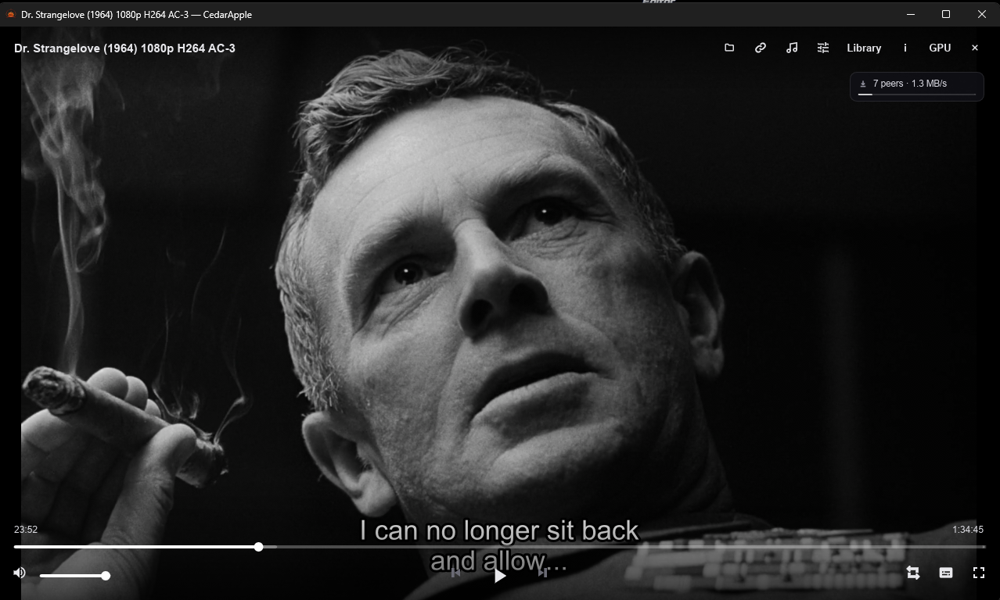

<div align="center">


# CedarApple

A desktop media player written in Rust, built on libmpv, that can stream
torrents directly.

[](https://github.com/skonester/CedarApple/actions/workflows/ci.yml)
[](https://github.com/skonester/CedarApple/releases/latest)
[](https://github.com/skonester/CedarApple/releases)
[](LICENSE)

[](https://www.rust-lang.org/)
[](https://slint.dev/)
[](https://mpv.io/)
[](https://github.com/ikatson/rqbit)
[](#install)

<br>



</div>

---

## Overview

CedarApple uses libmpv for decoding and rendering, so format support and
hardware decoding work the same way they do in mpv. Around that it adds a
graphical interface: a start screen, toolbar, menus, and a Settings dialog in
place of `mpv.conf`.

It can open local files, any URL mpv can play, magnet links, and `.torrent`
files. Torrents are streamed while they download, without a separate torrent
client. It also includes a library browser and a browser for Creative Commons
music.

## Features

### Torrent streaming

- Open a magnet link or `.torrent` file from the start screen or the Open Link
  dialog (`Ctrl+L`).
- CedarApple reads the torrent's file list, you pick a video, and it is
  streamed to mpv through a local HTTP server.
- Pieces for the file and position being watched are downloaded first, so a
  season pack does not have to finish before the first episode plays. Seeking
  moves the download to the new position.
- Peers, speed, and buffering status are shown in the player. Downloaded
  ranges are marked on the seek bar.
- Previously opened torrents and watched files are listed on the start screen.
  Their files can be revealed or deleted from there.
- Seeding is off by default. Settings → Torrents has options for seeding, UPnP
  port forwarding, a SOCKS5 proxy, peer encryption, and the network route.
- The torrent engine starts only when a magnet or torrent is opened.

> [!NOTE]
> The SOCKS5 proxy covers outgoing peer TCP connections and HTTP trackers. DHT
> and UDP trackers use the selected network route. Changing a torrent setting
> stops the current torrent; reopen it to continue with the new settings.

### Playback

- Play/pause, drag-to-seek, frame stepping, speed control, volume, mute, and
  fullscreen.
- Queue navigation, chapters, audio and subtitle track selection, repeat
  modes, and an on-screen display for changes.
- Resume positions are saved between launches.
- Hardware decoding can be toggled from the toolbar or Settings. Video is
  rendered through an OpenGL framebuffer.
- Screenshots, aspect ratio, deinterlacing, subtitle styling, audio options,
  and mpv logging are configurable in Settings.
- Discord Rich Presence shows the current title and whether it is paused.

### Library and providers

Open Library from the start screen, the player toolbar, or the context menu.
Sources are configured in Settings → Library.

- **Local folders:** browse the videos in a chosen folder.
- **Seanime:** connect to an existing Seanime server to browse the library and
  episodes, resume, and report watch history.
- **Parts plugins:** `.pts` scripts can add providers and respond to playback
  events. They reload when added or edited. See
  [PLUGIN_GUIDE.md](PLUGIN_GUIDE.md).

> [!WARNING]
> Only enable plugin scripts you trust. They can access the network and
> control playback.

### Free Music

Search and browse Creative Commons and public-domain music from Jamendo and the
Internet Archive (including its Free Music Archive mirror). It supports genre
and mood browsing, filters, album and artist pages, similar-track radio, and
queues.

Downloaded tracks are tagged with metadata, cover art, and licence
information, and come with a `.licence.txt` attribution file. Internet Archive
needs no setup. Jamendo needs a free client ID, set in Settings → Free Music or
with the `JAMENDO_CLIENT_ID` environment variable.

## Install

Builds are on the
[Releases page](https://github.com/skonester/CedarApple/releases/latest).

| Platform | Package | Notes |
| --- | --- | --- |
| **Windows** x86_64 | Portable `.zip` | Unzip and run `cedarapple.exe`. libmpv is included. |
| **Linux** x86_64 | AppImage | Self-contained, with libmpv bundled. |
| **Linux** x86_64 | Flatpak bundle | `flatpak install --user cedarapple-<version>-x86_64.flatpak` |
| **Linux** x86_64 | `.tar.gz` | Needs libmpv installed on the system. |
| **macOS** | Build from source | See below. |

Every release includes SHA-256 checksums.

## Keyboard shortcuts

<details>
<summary>Show all shortcuts</summary>

| Key | Action |
| --- | --- |
| `Space` / `K` | Play or pause |
| `Left` / `Right` | Seek by the short step (hold `Shift` for 1 second) |
| `J` / `L` | Seek by the long step (uppercase `L` cycles repeat) |
| `Home` / `End` | Jump to the beginning or end |
| `,` / `.` | Previous or next frame |
| `[` / `]` | Slower or faster |
| `Backspace` | Reset speed to 1x |
| `Page Up` / `Page Down` | Previous or next queue item |
| `Ctrl+Left` / `Ctrl+Right` | Previous or next chapter |
| `Up` / `Down` | Volume up or down |
| `M` | Mute or unmute |
| `F` / `F11` | Toggle fullscreen |
| `O` | Open a file |
| `Ctrl+L` | Open a link, magnet, or torrent |
| `C` / `Shift+C` | Show the info card (full or compact) |
| `S` | Take a screenshot |
| `Ctrl+,` | Open Settings |
| `Esc` | Close a menu or leave fullscreen |

Seek steps, volume step, and other player behavior can be changed in Settings.

</details>

## Building from source

Install Rust with [rustup](https://rustup.rs/), then the platform
dependencies:

| Platform | Dependencies |
| --- | --- |
| Ubuntu / Debian | `sudo apt install libmpv-dev libxkbcommon-dev libfontconfig1-dev` |
| Arch | The `mpv`, `libxkbcommon`, and `fontconfig` packages |
| macOS | `brew install mpv` |
| Windows | Nothing. `mpv-dev/` in this repository contains `libmpv-2.dll` and an MSVC `mpv.lib`. |

```sh
cargo run --release
```

Run the same checks as CI:

```sh
cargo build --profile ci --locked
cargo test --profile ci --locked
```

<details>
<summary>Updating the bundled Windows libmpv</summary>

If `mpv-dev/libmpv-2.dll` is replaced with a compatible newer DLL, regenerate
the import library (requires the Visual Studio Build Tools):

```sh
powershell -File mpv-dev/gen_def.ps1
```

</details>

<details>
<summary>Release builds</summary>

Pushing a `vX.Y.Z` tag runs
[`.github/workflows/release.yml`](.github/workflows/release.yml), which builds
the Windows ZIP, Linux tarball, AppImage, and Flatpak and publishes them with
checksums. To bake a Jamendo client ID into release builds, set the
`CEDARAPPLE_JAMENDO_CLIENT_ID` repository variable. See
[packaging/README.md](packaging/README.md) for manual packaging.

</details>

## Files and data

CedarApple stores its data in the standard per-platform application data and
cache directories:

| Path | Contents |
| --- | --- |
| `settings.json` | Player, UI, torrent, and library settings |
| `history.json` | Remembered torrents, watched files, and resume positions |
| `free-music.json` | Free Music settings |
| `cache/torrents/` | Torrent session data and downloaded content |
| `cache/free-music-covers/` | Cached Free Music artwork |

The screenshot folder and an optional mpv log file can be set in Settings.

## Project status

CedarApple is under active development. Direct playback, torrent streaming,
Free Music, and the Library are all working. Seanime and Parts plugins are
disabled by default. Provider playback opens one item at a time; a built-in
Seanime login, artwork grids, and custom plugin UI are not implemented yet.

More documentation:

- [PLUGIN_GUIDE.md](PLUGIN_GUIDE.md): the Parts scripting runtime reference
- [architecture.md](architecture.md): module overview
- [ports.md](ports.md): what was ported from Frame Player and Vivi

## License and attribution

<a href="LICENSE"></a>

CedarApple is free software under the **GNU General Public License, version 3
or later**; see [LICENSE](LICENSE). Copyright (c) 2026 skonester and
Evgenii Zakharov.

The torrent engine and related UI were ported from
[Frame Player](https://github.com/risenxxx/frame-player), GPL-3.0-or-later,
Copyright (c) Evgenii Zakharov. The Free Music browser, rendering changes, and
Linux packaging were ported from
[Vivi](https://github.com/Loafer19/vivi), MIT, Copyright (c) 2026 Ruslan
Popelyshyn.

Vendored `librqbit` crates are Apache-2.0. Additional inherited MIT notices and
the Apache-2.0 text are kept in [licenses/](licenses/); changes to the vendored
crates are described in [vendor/README-librqbit.md](vendor/README-librqbit.md).
